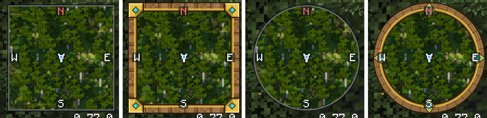

# Custom minimap frames

The frame around the minimap is a picture, so a resource pack can replace it. It takes one PNG, or a few if you want to cover every setting. No code.



## Try the example pack

1. Download [diorama-example-minimap-frame.zip](minimap-frames/diorama-example-minimap-frame.zip?raw=true).
2. Put the zip in your `.minecraft/resourcepacks` folder. In the game, **Options > Resource Packs > Open Pack Folder** opens it for you.
3. Turn the pack on in **Options > Resource Packs**.

The minimap gets an oak and gold frame, square or round. The zip is also a good place to start your own: open it, and paint over its pictures.

## Make your own

### 1. Set up the pack folder

Make a folder in `.minecraft/resourcepacks`, say `my-minimap-frame`, and give it this layout:

```
my-minimap-frame/
├── pack.mcmeta
└── assets/
    └── diorama/
        └── textures/
            └── gui/
                └── minimap_frame/
                    ├── classic_square.png
                    └── classic_round.png
```

`pack.mcmeta` tells Minecraft the folder is a resource pack. This one works on every version Diorama supports:

```json
{
  "pack": {
    "description": "My minimap frame",
    "pack_format": 15,
    "supported_formats": [15, 1000],
    "min_format": 15,
    "max_format": 1000
  }
}
```

### 2. Pick which frames to replace

Each picture belongs to one choice of the **Frame** and **Shape** settings under Minimap:

| File | Frame | Shape |
| --- | --- | --- |
| `classic_square.png` | Classic | Square |
| `classic_round.png` | Classic | Round |
| `minecraft_square.png` | Minecraft | Square |
| `minecraft_round.png` | Minecraft | Round |

You only need the ones you want to change. Classic is the default, so most players see the `classic` pictures. To show your frame on every setting, use the same picture under both names. With the Frame set to None, nothing is drawn.

Diorama's own pictures are in its jar, in the same folder.

### 3. Draw the frame

You don't need to know how big a player's minimap is. Draw the frame as it looks around one map size, and Diorama fits it to the rest.

The picture is 128 by 128 pixels, with a transparent background. It shows a map 120 pixels wide, with 4 pixels of room around it. Only the outer 16 pixels get used:

- The outer 4 pixels sit outside the map.
- The next 12 pixels sit on top of the map, so corners and ornaments can reach in over it. Keep the rest of this strip transparent, or the player loses that much of the map.
- Everything further in is ignored.

**Square frames** keep their four 16 by 16 corners as drawn. The edges between them repeat from the middle of each side, so anything you put in the middle stays there. The picture's own edge is 96 pixels long, so a pattern that repeats every 2, 3, 4, 6, 8, 12, 16, 24 or 32 pixels stays seamless along it. On other minimap sizes the pattern gets cut where the edge meets a corner, so give the corners their own design rather than continuing the pattern into them.

**Round frames** are a ring. Its outer edge touches the sides of the picture, and the map's edge is 4 pixels in from there. On a bigger or smaller minimap Diorama bends the ring to fit: it stays the same thickness and only gets longer or shorter around the circle. Anything you put at north, east, south or west stays there.

For more detail, make the picture 256, 512 or any other size up to 2048. Diorama reads it as the same picture, so at 512 the outer 16 pixels become the outer 64. Square frames stay sharp, so 128 is plenty for pixel art. Round frames are smoothed, because a curve can't line up with the screen's pixels, so draw them at 512 with soft edges, like the example pack.

### 4. Load it

Turn the pack on in **Options > Resource Packs**. After you change a file, press `F3` + `T` to reload packs; you don't need to restart the game.

## If your frame doesn't show

- Check the file names and folders against the layout above.
- Check the **Frame** and **Shape** settings. A `classic_round.png` only shows with the Classic frame on a round minimap.
- Make sure the pack is turned on, and above any other pack that has the same file. The top pack wins.
- Look in `.minecraft/logs/latest.log`. If a picture can't be read or is wider or taller than 2048, Diorama names the file there and draws no frame until it's fixed.
